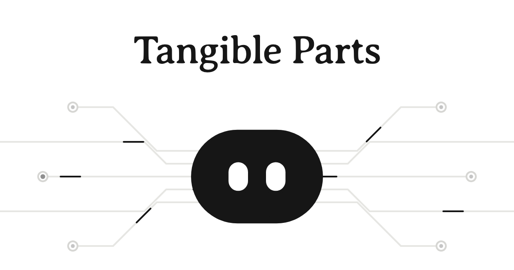
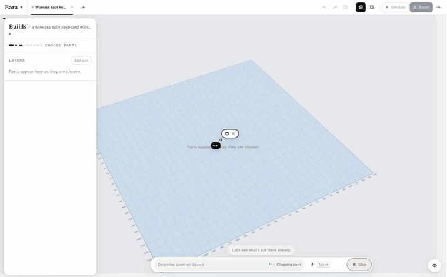
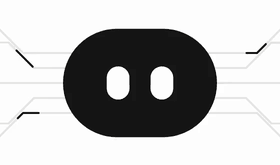
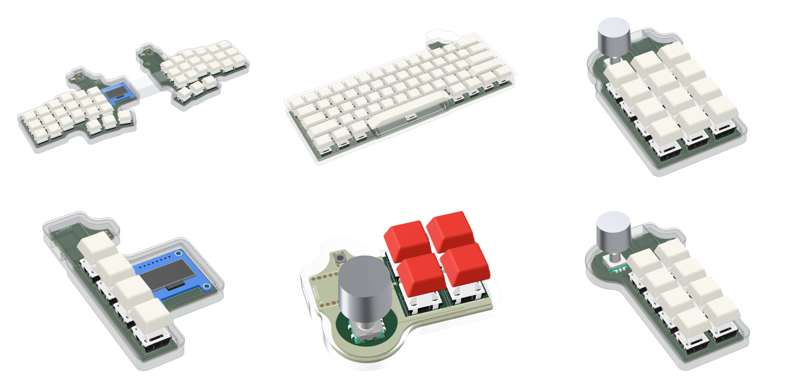
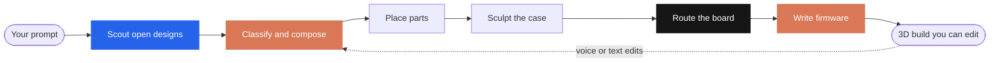

<p align="center">
  
</p>

<p align="center">
  <b>Describe a device. Get it built from real parts.</b><br />
  A <b>Cal Hacks 13.0</b> project by Pranav Achar and Nithin Aruswamy · <a href="https://tangible.parts">tangible.parts</a>
</p>

<p align="center">
  
  
  
  
  
  
</p>

---

Type "a wireless split keyboard with an OLED" and watch it come together. Bara picks real parts, lays them out in 3D, sculpts a case, routes a real KiCad board, and writes the firmware, explaining every choice as it goes. Then you change it in plain words or with your voice, and every edit is checked before it lands.

<p align="center">
  
</p>

## Meet Bara



Bara is the agent who builds with you: an ink oval with two eyes, nothing else. It walks onto the canvas, hovers over the part it's choosing, and shows how it feels through motion alone. Click a part to swap it, recolour it, move it, or ask about it. Hold <kbd>Space</kbd> to talk. Every change lands as a version you can undo.

<br clear="right" />

## What it builds

Each of these started as one sentence.

<p align="center">
  
</p>

## How a build works



<table>
  <tr><td>🔵 <b>Scout</b></td><td>Finds open designs that already exist, so Bara reuses before it invents.</td></tr>
  <tr><td>🟠 <b>Compose</b></td><td>Breaks the device into function blocks and picks one real part for each, with reasons.</td></tr>
  <tr><td>⚫ <b>Board</b></td><td>pcbnew builds it, Freerouting routes it, kicad-cli checks it. DRC errors trigger a re-route.</td></tr>
  <tr><td>✅ <b>Checks</b></td><td>Electrical, mechanical, and a vision judge that asks if it actually looks like the device.</td></tr>
</table>

## Sponsor tools

| | Tool | What it does in Bara |
|---|---|---|
| 🟠 | **Anthropic Claude** | The engineer behind every decision. Sonnet 5.5 classifies the prompt, asks clarifying questions, picks parts (schema-locked to real part IDs), writes firmware, judges the render, and handles edits. Claude Code built the product, including an overnight loop that ran our test prompts, found root causes, and pushed fixes. |
| 🟣 | **Figma** | All design, made through Claude Code and the Figma MCP. FigJam teardown, a full design system with the agent's moods, a Make prototype of explode and focus, and design tokens pulled straight into `tokens.css`. |
| 🟢 | **OpenAI** | Bara's voice. gpt-4o-mini-tts speaks with a written personality, and gpt-4o-transcribe listens, hinted with the build's part names so "SSD1306" comes through right. |
| 🔵 | **You.com** | The first search on every build. Finds open designs with a real KiCad board, plus photos of the real product so the case looks right. |
| 🟩 | **Apify** | The Open Hardware Scout Actor ([actors/](actors/bara-hardware-scout)). Fallback search, and it prices every part so the BOM has live stock and buy links. |
| 🔶 | **Cerebras** | A fast path for quick, constrained calls, with Claude as backup and keyword rules as the last resort, so a build always finishes. |

## Run it

You need [uv](https://docs.astral.sh/uv/), [pnpm](https://pnpm.io), and Node.

```bash
scripts/dev.sh
```

That starts the engine on `127.0.0.1:8790` and the app on http://localhost:5173. No keys? Open http://localhost:5173/?mock=1 to replay a recorded build in the browser.

Live builds need `ANTHROPIC_API_KEY`, plus KiCad 10 and Freerouting for boards. `OPENAI_API_KEY`, `YOU_API_KEY`, `APIFY_TOKEN`, and `CEREBRAS_API_KEY` are optional. Keys come from the environment only.

<details>
<summary>Tests and repo layout</summary>

```bash
cd server && uv run pytest
cd web && pnpm test
scripts/e2e.sh
```

```
spec/      the contract between app and engine (SPEC.md, schemas, fixtures)
server/    FastAPI engine (src/bara), catalog and assets in data/
web/       Vite + React + React Three Fiber app
actors/    the Apify Open Hardware Scout
scripts/   dev, e2e, deploy, and render scripts
```

</details>

## Disclosure

Before the event we wrote the spec and a labelled set of test prompts, and ran a small routing experiment to check the idea was feasible. None of that experiment's code is in this repo. We used Nithin's public UI skill library, the same one we used in Etch. Everything in this repo was written at Cal Hacks 13.0.
