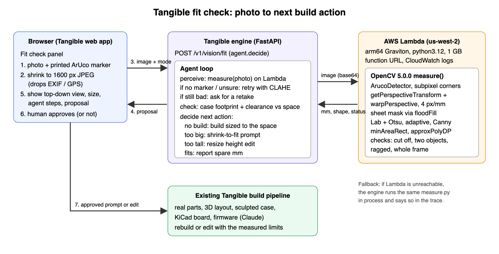

# Tangible fit check: technical report

OpenCV AI Competition 2026 (powered by AWS). Branch `opencv-aws` of https://github.com/PranavAchar01/bara.

Prior work: Tangible was first shown at Cal Hacks 13.0 (Oct 24-25, 2026); the OpenCV/AWS vision feature was built for this competition. New for this competition: `server/src/bara/vision/`, `server/aws/`, `server/scripts/vision_eval.py`, `server/tests/test_vision.py`, `web/src/components/FitCheck.tsx`, `e2e/fit_check.mjs` and this folder.

## 1. Problem

Tangible turns a sentence ("a 2x2 macropad with a volume knob") into a device built from real parts: a 3D layout, a sculpted case, a KiCad board and firmware. Until now the case size came only from the parts. People build devices for a real place: a shelf gap, a desk corner, a drawer, the footprint of an old remote. A case that is 6 mm too wide does not go in, and most people do not own calipers or know how to measure a curved outline.

## 2. Users

- Hobbyists and makers who want a device for a specific spot.
- People replacing an existing object (a remote, a controller) who want the new case to match its outline.
- Anyone using Tangible on a phone, where one photo is easier than typing dimensions.

## 3. What it does

1. The user prints a 40 mm ArUco marker (the panel links to `/v1/vision/marker.png`), lays it next to the space or object, and takes one photo from above.
2. OpenCV 5 finds the marker, rectifies the photo to a top-down view at 4 px/mm, segments the space or object, and measures it in millimetres with a shape class (rectangle, round, oval, freeform).
3. An agent reads that measurement and picks the next action for the build:
   - no build open: propose a build sized to the space (the measured footprint minus clearance goes into the prompt as a size limit);
   - the open case is too big: propose a shrink-to-fit prompt with the target size;
   - the footprint fits but a height limit is exceeded: propose a resize edit on the case height;
   - it fits: report the spare millimetres;
   - the photo is not usable (no marker, object cut off, two objects, low contrast): retry once with CLAHE contrast enhancement, then ask for a retake with a specific tip.
4. The user sees the annotated top-down view, the size, every step the agent took, and one approve button. Nothing changes until they approve. Approving sends the prompt or edit into the existing Tangible build pipeline, and "Check again" re-runs the same photo against the new case.

What the camera sees decides the next action. Different photos produce different actions, and a bad photo produces a retake request instead of a guess.

## 4. Architecture



- Browser: the `FitCheck.tsx` panel, opened from the workspace toolbar. The photo is redrawn on a canvas to a 1600 px JPEG before upload, which also drops EXIF and GPS.
- Engine (FastAPI): `POST /v1/vision/fit` runs `agent.decide()` in a thread pool. `GET /v1/vision/status` and `GET /v1/vision/marker.png` support the panel.
- AWS Lambda: `tangible-fit-measure`, arm64 (Graviton), python3.12, 1024 MB, 30 s timeout, behind a function URL. It runs the same `measure.py`, which imports only `cv2` and `numpy`. Each call logs one JSON line to CloudWatch with status, timings and sizes, never the image.
- Fallback: if Lambda is unreachable the engine measures in process and the step trace says `local` with the error, so the feature keeps working.

### Agent workflow and trace

The diagram's middle box is the agent. Perception is the OpenCV measurement, the decision is the fit check against the open case, and the action is a proposal the person approves. Every response carries the step trace, and the panel lists it. This trace is from evaluation scene 6 (a 40 x 30 mm space with a 41.8 x 31.8 mm case open), copied from `eval/results.json`:

```json
[{"tool": "measure", "args": {"enhance": false}, "status": "ok", "where": "local", "ms": 208.1},
 {"tool": "fit_check", "case_mm": [41.8, 31.8, 25.0], "space_mm": [35.7, 26.0],
  "footprint_fits": false, "spare_mm": -6.1, "height_fits": true},
 {"decide": "propose_shrink", "over_mm": 6.1}]
```

A photo the agent cannot trust ends differently. Scene 5 came back `unsure`, the agent retried with CLAHE, got `unsure` again and asked for a retake:

```json
[{"tool": "measure", "args": {"enhance": false}, "status": "unsure", "where": "local", "ms": 439.1},
 {"tool": "measure", "args": {"enhance": true}, "status": "unsure", "where": "local", "ms": 369.4,
  "why": "first pass was unsure, retrying with contrast boost"},
 {"decide": "ask_retake", "reason": "cut_off"}]
```

In the running app the `where` field reads `aws-lambda`. The end-to-end run's responses, with the Lambda traces, are saved in `e2e/e2e-log.json`.

Human control: build, shrink and height proposals need a click (`needs_approval: true`); a fit report and a retake request change nothing. Observability: the trace in each response, plus one CloudWatch log line per Lambda call.

## 5. OpenCV 5 implementation (`server/src/bara/vision/measure.py`)

Pinned `opencv-python-headless==5.0.0.93`.

1. Decode with `cv2.imdecode`; downscale to at most 1600 px on the long side.
2. `cv2.aruco.ArucoDetector` with `DICT_4X4_50` and `CORNER_REFINE_SUBPIX`. Subpixel refinement removed a systematic size error of about 9% that came from corner jitter.
3. `cv2.getPerspectiveTransform` from the marker corners to a square of known size, then `cv2.warpPerspective` to a top-down image at 4 px/mm covering 450 mm each way from the marker. A validity mask tracks which output pixels came from the photo.
4. Sheet mask: `cv2.floodFill` from the marker's white margin, so the printed sheet is not mistaken for the object.
5. Segmentation, tried in order until one passes the checks:
   - `lab_otsu`: Lab colour distance from the median background, percentile-normalised, Otsu threshold computed over surface pixels only;
   - `adaptive`: `cv2.adaptiveThreshold`;
   - `edges`: `cv2.Canny` plus morphological closing.
6. Candidates from `cv2.findContours`, skipping the contour that contains the marker centre and anything under 400 mm2.
7. Measurement: `cv2.minAreaRect` for width and depth, `cv2.approxPolyDP` and circularity for the shape class.
8. Quality checks on the best candidate: `cut_off` (touches the photo edge), `whole_frame` (over 80% of the view), `ragged` (solidity under 0.6), `two_objects` (a second candidate at least 60% as large), `no_object`.
9. Contrast retry: CLAHE on the L channel, run by the agent when the first pass fails.
10. Output: status (`ok`, `unsure`, `no_object`, `no_marker`), millimetres, shape, every strategy tried with its issues, and an annotated JPEG.

## 6. AWS deployment (`server/aws/`)

- `deploy.py` installs pinned wheels for `aarch64-manylinux_2_28` / python 3.12 (`opencv-python-headless==5.0.0.93`, `numpy==2.2.6`) into `aws/dist` and zips them with `handler.py` and `measure.py` (52 MB).
- It then creates the execution role (AWSLambdaBasicExecutionRole only), uploads the zip through S3 because it is over the 50 MB direct upload limit, creates or updates the function, and creates a public function URL with CORS.
- Live endpoint: https://utmqhifgnhqgep65hqqhuh56aa0rukxb.lambda-url.us-west-2.on.aws/ (GET returns the OpenCV version; POST `{"image_b64": ...}` returns the measurement).
- The engine calls it when `BARA_VISION_URL` is set.

## 7. Evaluation (`server/scripts/vision_eval.py`, results in `eval/results.json`)

All numbers below are on synthetic photos with known ground truth. Each scene renders a table texture, a printed marker sheet and an object of known size, then applies a random perspective tilt, lighting falloff, blur, sensor noise and JPEG compression. Every scene is seeded, so a rerun gives the same numbers. We did not have a labelled set of real photos in time, so these numbers do not show real-world accuracy yet.

Accuracy, 56 scenes (7 sizes from 40x30 to 170x110 mm, rectangles and round shapes, 4 tilt levels):

| metric | value |
|---|---|
| measured with status ok | 53 / 56 |
| mean absolute error | 0.42 mm |
| p95 error | 1.4 mm |
| max error | 2.6 mm |
| p95 relative error | 1.69% |
| shape class correct | 53 / 53 |
| median time per photo, local | 138 ms |

By tilt: 0.05 gave 13/14 (MAE 0.25 mm), 0.12 gave 14/14 (0.42), 0.18 gave 14/14 (0.51), 0.25 gave 12/14 (0.52). The three misses: one small 40x30 round object came back `unsure` instead of a size, and two strongly tilted scenes lost the marker and asked for a retake. None of the 56 returned a wrong size.

Failure cases, 10 seeded scenes each, where the right answer is to ask for a retake:

| case | retake requested |
|---|---|
| no marker in the photo | 10 / 10 |
| object cut off at the photo edge | 10 / 10 |
| two objects in view | 9 / 10 |

The one two-objects miss measured the correct object (111.6 x 69 mm for 110 x 70) instead of asking.

Agent decisions, the same 56 scenes against an open case set a few millimetres (up to 8) bigger or smaller than the room left after clearance. The right action comes from the true size, the agent's from the photo:

| outcome | count |
|---|---|
| right action (report the fit, or propose a shrink) | 53 / 56 |
| asked for a retake instead | 3 / 56 |
| wrong action | 0 / 56 |

Each decision is stored with its full step trace in `eval/results.json` (`agent_decisions`).

AWS Lambda vs local, 20 runs of the same photos: the first call took 3.4 s round trip (cold start). After that the medians were 200 ms local, 635 ms measurement inside Lambda and 1035 ms round trip from the engine. The machine was also running a browser test and a screen recording during this run, so the local and round-trip times are on the slow side. Lambda and local agreed to 0.0 mm on width in every run.

Tests: `server/tests/test_vision.py` has 9 tests (known sizes within 2 mm; a photo without a marker leads to a CLAHE retry and then a retake; a sized build proposal; a shrink proposal; a fit report plus a height edit; the HTTP route and the marker PNG). End to end, `e2e/fit_check.mjs` drives the real app through a live build, a too-small space, the approve step, the rebuild and a roomy space, and saves screenshots and the agent's responses to `e2e/`.

## 8. Limitations

- Evaluation is synthetic. Real photos add shadows, glare, curled paper and a marker that is not flat, so real accuracy will be lower than these numbers.
- One photo gives a 2D footprint. Height comes from the number the user types, not the photo.
- The marker must lie in the same plane as the space it measures. A drawer floor photographed with the marker on the counter will be wrong.
- Strong tilt starts to lose the marker; the agent then asks for a retake.
- Low-contrast scenes (a white object on white paper) depend on the CLAHE retry and can fail.
- A Lambda cold start adds about 3 s to the first call.
- The build engine does not enforce a size limit yet. Shrink to fit rebuilds the same device on the same canvas with the limit in its prompt, but the result is not guaranteed to be smaller. In the end-to-end run a 66 x 78 mm case came back as 67 x 92 mm, and Check again reported that it still did not fit.

## 9. Responsible use

- The photo is resized and re-encoded in the browser, which strips EXIF and GPS before it leaves the device.
- Lambda logs only status, timings and sizes. Neither the engine nor Lambda stores images.
- The agent never changes a design on its own: every proposal needs a click, and a doubtful measurement becomes a retake request, not a number.
- The panel shows the annotated outline next to the size, so the user can see what was measured before acting on it.
- The endpoint is public for judging, with a 4 MB payload cap and no storage.

## 10. Reproduce

```bash
cd server
uv sync                                    # pins opencv-python-headless 5.0.0.93
uv run pytest tests/test_vision.py         # 9 tests
uv run python scripts/vision_eval.py ../docs/hackathons/opencv26/eval \
  --lambda https://utmqhifgnhqgep65hqqhuh56aa0rukxb.lambda-url.us-west-2.on.aws/

# deploy your own copy (AWS credentials from the environment)
uv run python aws/deploy.py --build        # build the arm64 package only
uv run python aws/deploy.py                # build and deploy, prints the function URL

# run the app with the fit check
export BARA_VISION_URL=<function url> BARA_MOCK=0 ANTHROPIC_API_KEY=<key>
uv run bara-server
cd ../web && pnpm install && pnpm dev
```
